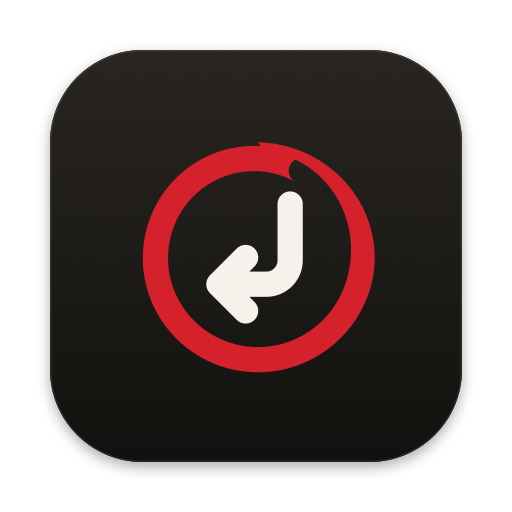
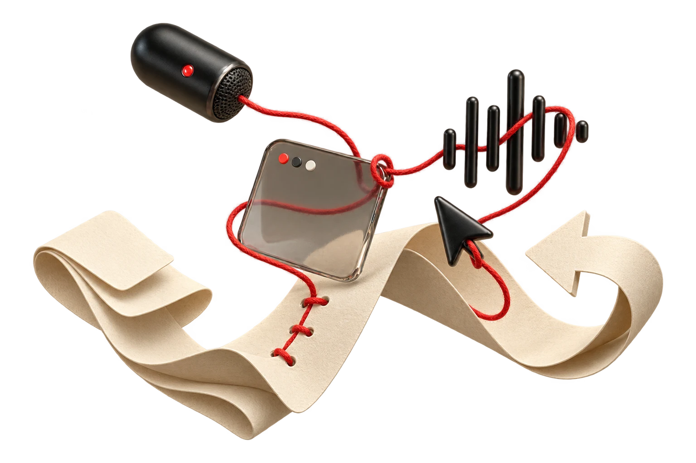

<p align="center">
  
</p>

<h1 align="center">Linefeed</h1>

<p align="center"><em>Your words, with their world intact.</em></p>

<p align="center">
  Private voice dictation for macOS that keeps what you say beside the part of
  the screen you mean.
</p>

<p align="center">
  <a href="../../releases/latest"></a>
  
  
</p>

<p align="center">
  
</p>

<h2 align="center">Sometimes the shortest explanation is<br><em>“this thing, right here.”</em></h2>

<p align="center">
  Linefeed lets your pointer finish the sentence. Speak as you normally would,
  circle the part of the screen you mean, and keep moving.
</p>

## How it works

| Moment | Default shortcut | What happens |
|---|---|---|
| **Quick note** | Hold `⌥` | Linefeed listens while you hold, then places your words where you're typing. |
| **Point at it** | Draw a circle | That part of the screen is captured and kept beside the words spoken around it. |
| **Hands-free** | Press `⌥⌘` | Talk as long as you need, then press `⌥⌘` again. Holding `⌥` and pressing `⌘` turns a quick note hands-free. |
| **Never mind** | `Esc` | Discards the recording. Nothing is saved. |

Both shortcuts can be changed in **Settings → Shortcuts**: a modifier chord,
or a key with ⌃ or with ⌘ plus another modifier (function keys work alone).
Quick notes can be held or tapped, and modifier chords can also be
double-tapped.

## What you get

- **A recording island** under the camera notch with live voice feedback, a
  timer, and a thumbnail for each screenshot. Screens without a notch get a
  floating island.
- **Text placed where you're typing.** Linefeed pastes your words into the app
  you were using, then any screenshots. After a text-only note it puts your
  own clipboard back; with screenshots, the session stays on the clipboard so
  you can paste it again anywhere.
- **Local speech recognition** with three models: **Accurate** for English
  and two dozen European languages, **English** tuned for English speech, and
  **Fast**, the quickest, also English only.
- **Writing that reads well.** *Polished* drops fillers, follows spoken “new
  line” and “new paragraph”, and finishes sentences. *Verbatim* keeps every
  word. Technical terms come out right (`GitHub`, `JSON`, `npm`), and your own
  vocabulary file fixes names Linefeed mishears. Filler removal, spoken
  layout commands, and technical terms are English rules, so they stay out of
  the way when you dictate in another language.
- **Smart cleanup** with Apple Intelligence on macOS 26 and later, entirely on
  your Mac. Anything that looks like a rewrite instead of a cleanup is
  discarded in favor of your own words.
- **History** you can search, copy again, and open in Finder, with each
  screenshot shown next to the words you said around it.
- Start and stop sounds, opening at login, and guided setup that asks for one
  permission at a time.

## Download

Linefeed needs an Apple silicon Mac running macOS 14 or later.

1. Download `Linefeed-macOS-arm64.dmg` from the [latest release](../../releases/latest).
2. Open it and drag **Linefeed** onto **Applications**.
3. Open Linefeed from Applications and follow the setup for microphone,
   screen recording, accessibility, language, and speech.

> [!NOTE]
> Linefeed isn't notarized by Apple yet. If macOS says it can't verify
> Linefeed, close that message and open **System Settings → Privacy &
> Security**. Under **Security**, choose **Open Anyway**, authenticate, and
> confirm **Open**. You only need to do this once. Apple's guide:
> [Open a Mac app from an unknown developer](https://support.apple.com/guide/mac-help/open-a-mac-app-from-an-unknown-developer-mh40616/mac).

## Private by design

- Speech recognition runs on your Mac through
  [FluidAudio](https://github.com/FluidInference/FluidAudio). There is no
  account and no upload. Each speech model downloads once, from Hugging Face,
  when you choose it.
- Audio is deleted as soon as it's transcribed. If transcription fails, it
  stays in that session's folder as `recording.caf`, so nothing is lost.
- Screenshots happen only when you circle something.
- History lives in `~/Library/Application Support/Linefeed/History`, outside
  folders that sync to iCloud. It keeps up to 500 MB and makes room by
  removing the oldest sessions first.

Each session is a folder with your transcript, a readable `context.md`, and
its screenshots:

```text
2026-11-07T14-03-11Z-<id>/
├── session.json
├── context.md
├── screenshot-001.png
└── screenshot-002.png
```

## Your vocabulary

Open **Settings → Writing → Edit vocabulary…** to teach Linefeed words it
mishears. The file lives at
`~/Library/Application Support/Linefeed/vocabulary.json`:

```json
{
  "terms": {
    "cube cuttle": "kubectl",
    "engine x": "nginx"
  }
}
```

Keys are what Linefeed wrote; values are what you meant. Matching is
whole-word and ignores case, phrases win over single words, and filenames,
domains, and paths are left alone. Changes apply to your next recording.
Avoid ordinary words as keys: `"read me": "README"` would rewrite every
“read me” you say.

## Build from source

Install Xcode 26 or later (older SDKs build, but without Smart cleanup), then:

```sh
./scripts/setup-signing-identity.sh   # once: keeps privacy permissions across rebuilds
./scripts/build-app.sh                # builds, signs, and opens .build/Linefeed.app
```

The setup script creates a local signing identity named
“Linefeed Local Development” in your login keychain. macOS ties privacy
permissions to an app's signature, so without it every rebuild would ask
again.

To package a disk image: `./scripts/package-dmg.sh`.

<details>
<summary><strong>Development</strong></summary>

### Tests

```sh
swift test -Xswiftc -strict-concurrency=complete
```

### Structure

`Sources/LinefeedCore` holds the pure rules (shortcut recognition, text
polishing, session storage rules, circle detection, the brand geometry) and
is tested on its own. `Sources/Linefeed` is the app, organized by feature.
[`docs/ARCHITECTURE.md`](docs/ARCHITECTURE.md) has the full map, and
[`CONTRIBUTING.md`](CONTRIBUTING.md) explains how to work in it.

### Brand assets

The app icon, website icons, and the README icon are generated from
`Sources/LinefeedCore/Brand`:

```sh
./scripts/render-brand-assets.sh
```

### Website

```sh
cd site
npm install
npm run dev
```

`npm run build` writes the production site to `site/dist`.

</details>

## License and attribution

Linefeed is released under the [MIT License](LICENSE). It began as a
derivative of [better-voice](https://github.com/TarunTomar122/better-voice)
by Tarun Tomar, whose copyright and permission notice are preserved. See
[`NOTICE.md`](NOTICE.md) for full attribution and third-party notices.
